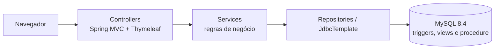

<div align="center">

# 🍔 SnackFlow

**Sistema de gestão de lanchonetes: pedidos, estoque e vendas em um só lugar.**

[](https://github.com/SnackFlow-A3-QA/A3-QA-Sistema-de-Gestao-de-Lanchonetes/actions/workflows/ci.yml)
[](https://sonarcloud.io/summary/new_code?id=SnackFlow-A3-QA_A3-QA-Sistema-de-Gestao-de-Lanchonetes)
[](https://sonarcloud.io/summary/new_code?id=SnackFlow-A3-QA_A3-QA-Sistema-de-Gestao-de-Lanchonetes)


</div>

> Projeto da **A3** de Garantia e Qualidade de Software, UNISUL (Prof. Jorge Werner e Armando Cardoso).
> O foco é a qualidade do processo: testes automatizados, cobertura de **80%**, análise estática com *quality gate* e gestão de configuração no GitHub.

## ✨ Funcionalidades

| Módulo | Descrição | Perfis |
|---|---|---|
| Login e funcionários | Autenticação e gestão de colaboradores | ADMIN |
| Cardápio e produtos | Produtos com ficha técnica, opções (adicionais e remoções), custo e margem | ADMIN |
| Ponto de venda (PDV) | Carrinho, clientes, confirmação transacional, entrega e cancelamento | ADMIN, CAIXA |
| Cozinha (KDS) | Fila de pedidos em preparo; marcar como PRONTO | ADMIN, COZINHA |
| Estoque | Ingredientes, compras, perdas, ajustes e extrato imutável | ADMIN, ESTOQUE |
| Clientes | Cadastro e busca rápida com validação de CPF (dentro do PDV) | ADMIN, CAIXA |
| Relatórios | Faturamento, mais vendidos, reposição, perdas e ajustes | ADMIN |

## 🧱 Arquitetura



## 🛠️ Tecnologias

- **Java 21** · **Spring Boot** (Web MVC, Data JPA, Security, Validation)
- **Thymeleaf** + Tailwind CSS (CDN) · **MySQL 8.4** em contêiner Docker
- **JUnit 5**, **Mockito**, **AssertJ** e **Testcontainers** nos testes
- **JaCoCo** (cobertura), **SonarCloud** (análise estática), **GitHub Actions** (CI)

## ✅ Qualidade

- Cobertura mínima de **80%** (o build falha abaixo disso)
- *Quality gate* do SonarCloud aprovado a cada push e pull request
- Todos os issues resolvidos antes da entrega

## 🚀 Como executar

**Pré-requisitos:** JDK 21, Maven (ou o `mvnw` do projeto) e **Docker aberto**.

```bash
# 1. Banco local (aplica database/lanchonete.sql na primeira execução)
docker compose up -d

# 2. Aplicação em http://localhost:8080
mvn spring-boot:run

# 3. Testes + cobertura (exige Docker)
mvn verify

Se não funcionar o "mvn" use "./mvnw"
```

Para voltar o banco ao estado inicial: `docker compose down -v && docker compose up -d`.
Relatório de cobertura: `target/site/jacoco/index.html`.

A aplicação lê `DB_URL`, `DB_USER` e `DB_PASSWORD`; os padrões apontam para o MySQL do `docker-compose.yml`.

### Usuários de exemplo (apenas desenvolvimento)

Senha de todos: `snackflow123`

| Login | Perfil | Tela inicial |
|---|---|---|
| `admin` | ADMIN | `/pdv` |
| `ana.caixa` | CAIXA | `/pdv` |
| `marcos.cozinha` | COZINHA | `/cozinha` |
| `julia.estoque` | ESTOQUE | `/estoque` |
| `roberto.antigo` | CAIXA (inativo, login recusado) | n/a |

## 📁 Estrutura

```
database/          script do banco (DDL + dados de exemplo)
src/main/java      código-fonte (um pacote por módulo)
src/main/resources templates Thymeleaf e configurações
src/test/java      testes unitários, web e de integração
.github/           CI, templates de issue e de pull request
docs/              documentação do projeto
```

## 🔀 Convenção de commits

Seguimos o [Conventional Commits](https://www.conventionalcommits.org/pt-br/): commits pequenos, com uma única finalidade.

| Prefixo | Uso |
|---|---|
| `feat:` | nova funcionalidade |
| `fix:` | correção de defeito |
| `test:` | criação/ajuste de testes |
| `refactor:` | melhoria sem mudar comportamento |
| `docs:` | documentação |
| `chore:` / `ci:` | configuração e pipeline |

Branch principal: `main`. Mudanças entram por pull request com CI verde.

## 👥 Equipe e divisão de trabalho

| Integrante | Papel | GitHub |
|---|---|---|
| 1. Lucas N. | DevOps + Desenvolvedor (líder) | @Lucas Nicoletti |
| 2. Guilherme H. | DevOps + Desenvolvedor | [@Guillyam](https://github.com/Guillyam) |
| 3. Rafael T. | Desenvolvedor + Testador | @Rafael T. |
| 4. Rodrigo F. | Desenvolvedor + Testador | [@rodrigofranz](https://github.com/rodrigofranz) |

| Responsável | Módulos (pacotes) |
|---|---|
| Lucas N. | `pedido` (PDV), `cozinha` |
| Guilherme H. | `funcionario`, `config` (segurança e layout), `cliente`, pipeline de CI e Sonar |
| Rafael T. | `produto` (cardápio), `relatorio` (vendas) |
| Rodrigo F. | `estoque`, `relatorio` (estoque) |

## 📄 Licença

Distribuído sob a licença MIT. Veja [LICENSE](LICENSE).
