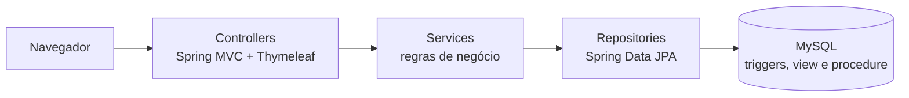

<div align="center">

# 🍔 SnackFlow

**Sistema de gestão de lanchonetes: pedidos, estoque e vendas em um só lugar.**

[](https://github.com/SnackFlow-A3-QA/A3-QA-Sistema-de-Gestao-de-Lanchonetes/actions/workflows/ci.yml)
[](https://sonarcloud.io/summary/new_code?id=SnackFlow-A3-QA_A3-QA-Sistema-de-Gestao-de-Lanchonetes)
[](https://sonarcloud.io/summary/new_code?id=SnackFlow-A3-QA_A3-QA-Sistema-de-Gestao-de-Lanchonetes)


</div>

> Projeto da **A3** de Garantia e Qualidade de Software, UNISUL (Prof. Jorge Werner e Armando Cardoso).
> O foco é a qualidade do processo: testes automatizados, cobertura de **80%**, análise estática com *quality gate* e gestão de configuração no GitHub.

## ✨ Funcionalidades

| Módulo | Descrição | Perfis |
|---|---|---|
| Login e funcionários | Autenticação e gestão de colaboradores | ADMIN |
| Produtos e categorias | Catálogo com ativação/inativação segura | ADMIN, CAIXA (leitura) |
| Novo pedido (PDV) | Frente de caixa com finalização transacional | ADMIN, CAIXA |
| Painel de pedidos (Kanban) | ABERTO → EM_PREPARO → PRONTO → ENTREGUE | ADMIN, CAIXA, COZINHA |
| Controle de estoque | Saldos, movimentações e extrato de auditoria | ADMIN, CAIXA |
| Clientes | Cadastro com validação de CPF e histórico | ADMIN, CAIXA |
| Relatórios | Faturamento, mais vendidos, perdas e ajustes | ADMIN |

## 🧱 Arquitetura



## 🛠️ Tecnologias

- **Java 21** · **Spring Boot** (Web MVC, Data JPA, Security, Validation)
- **Thymeleaf** no front-end · **MySQL** como banco
- **JUnit 5**, **Mockito** e **Testcontainers** nos testes
- **JaCoCo** (cobertura), **SonarCloud** (análise estática), **GitHub Actions** (CI)

## ✅ Qualidade

- Cobertura mínima de **80%** (o build falha abaixo disso)
- *Quality gate* do SonarCloud aprovado a cada push e pull request
- Todos os issues resolvidos antes da entrega

## 🚀 Como executar

**Pré-requisitos:** JDK 21, Maven, MySQL 8 e Docker (para os testes de integração).

```bash
# Rodar testes + cobertura (exige Docker)
mvn verify

# Subir a aplicação
mvn spring-boot:run
```

> O script do banco e a configuração de conexão serão documentados aqui conforme o projeto evoluir.

## 📁 Estrutura

```
src/main/java      código-fonte da aplicação
src/main/resources templates e configurações
src/test/java      testes unitários e de integração
.github/           CI, templates de issue e de pull request
```

## 🔀 Convenção de commits

Seguimos o [Conventional Commits](https://www.conventionalcommits.org/pt-br/): commits pequenos, com uma única finalidade.

| Prefixo | Uso |
|---|---|
| `feat:` | nova funcionalidade |
| `fix:` | correção de defeito |
| `test:` | criação/ajuste de testes |
| `refactor:` | melhoria sem mudar comportamento |
| `docs:` | documentação |
| `chore:` / `ci:` | configuração e pipeline |

Branch principal: `main`. Mudanças entram por pull request com CI verde.

## 👥 Equipe e divições (Em discussão)


| Integrante | Papel | GitHub |
|---|---|---|
| 1 Lucas N. | DevOps + Desenvolvedor | [@Lucas Nicoletti](https://github.com)|
| 2 Guilherme H. | DevOps + Desenvolvedor | [@Guillyam](https://github.com) |
| 3 Rafael T. | Desenvolvedor + Testador | [@Rafael T.](https://github.com) |
| 4 rodrigo F. | Desenvolvedor + Testador | [@rodrigofranz](https://github.com) |

| Responsável | Módulos (pacotes) |
|---|---|
| (membro 1, DevOps) | `pedido` |
| (membro 2, DevOps) | `funcionario`, `config` (segurança), pipeline de CI |
| (membro 3) | `produto`, `estoque` |
| (membro 4) | `cliente`, `relatorio` |

## 📄 Licença

Distribuído sob a licença MIT. Veja [LICENSE](LICENSE).
